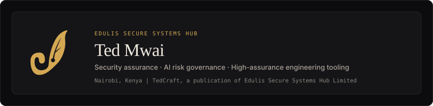
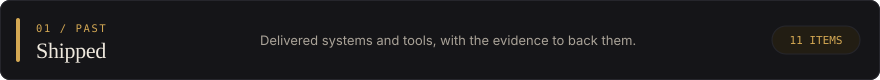
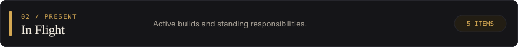
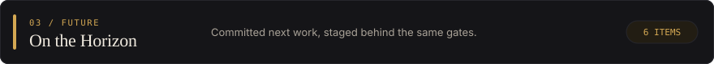

<!-- BEGIN:hero -->
<picture>
  <source media="(prefers-color-scheme: dark)" srcset="assets/cards/hero-dark.svg">
  <source media="(prefers-color-scheme: light)" srcset="assets/cards/hero-light.svg">
  
</picture>
<!-- END:hero -->

<!-- BEGIN:summary -->
Security assurance engineer, AI risk strategist and principal of **Edulis Secure Systems Hub Limited**. I build high-assurance verification tooling: find the systemic cause, eliminate the defect class at the root, and keep it fixed with automated guardrails.
<!-- END:summary -->

### Edulis Secure Systems Hub

<!-- BEGIN:edulis -->
> **A high-assurance systems verification, access governance and security engineering studio, operating from Kenya for global infrastructure.**

Named for *mahiinga* (*Canna edulis*), the highland plant of Kandara in Murang'a. Its signet is a shoot caught breaking ground from the rhizome: growth made visible, security expressed through composure rather than padlocks. **SSH** nods to Secure Shell: disciplined, encrypted, wire-level engineering.

| Practice | Focus |
| :--- | :--- |
| **Systems verification** | Contract-first test harnesses, wire-level evidence, zero-regression release gates. |
| **Access governance** | Least-privilege RBAC, automated access reviews, revocation-latency analysis. |
| **Security engineering** | Stdlib-first security tooling, threat emulation, AI risk evaluation. |

Editorial ledger: [TedCraft, a publication of Edulis Secure Systems Hub Limited](https://tedcraft.dev).
<!-- END:edulis -->

---

### Shipped

<!-- BEGIN:shipped -->
<picture>
  <source media="(prefers-color-scheme: dark)" srcset="assets/cards/lane-shipped-dark.svg">
  <source media="(prefers-color-scheme: light)" srcset="assets/cards/lane-shipped-light.svg">
  
</picture>

| Work | What it does | Status | Links |
| :--- | :--- | :--- | :--- |
| **Unnest Studio** `v2.1.0` | Privacy-first streaming JSON to CSV / Excel studio. Two-pass schema discovery, O(1) memory per record, zero bytes leave the machine. *(Python · JavaScript)* | `PUBLIC` | [Repo](https://github.com/teddymwai/unnest-studio) · [Demo](https://teddymwai.github.io/unnest-studio/) · [Dossier](https://tedcraft.dev/works/unnest-studio/) |
| **NIST NICE Framework Mapper** | Maps scenario telemetry and assessment artefacts to NIST NICE (SP 800-181r1) work roles and KSAs, entirely client-side. *(Python · JavaScript)* | `PUBLIC` | [Repo](https://github.com/teddymwai/nice-framework-mapper) · [Demo](https://teddymwai.github.io/nice-framework-mapper/) · [Dossier](https://tedcraft.dev/works/nice-framework-mapper/) |
| **RangeMaster Cockpit** `v1.4.0` | Operator panel for HAR-driven wire-contract verification, Playwright agents, and mutation interlocks. *(Python · Playwright · OpenStack)* | `PRIVATE` | [Dossier](https://tedcraft.dev/works/rangemaster-cockpit/) |
| **GitLab Resilient Orchestrator** | Fault-tolerant bulk provisioning, staging promotion and MR lifecycle across 43 repositories. 0 conflicts, standard library only, jittered backoff. *(Python · GitLab API)* | `PUBLIC` | [GitLab](https://gitlab.com/teddymwai/gitlab-resilient-orchestrator) · [Dossier](https://tedcraft.dev/works/resilient-orchestrator/) |
| **Practitioner & Agentic AI Curriculum** | 43 standalone repositories across 4 tiers: systems programming, wire-protocol analysis and MCP-conforming Hackbot / Defense agents. *(C++20 · Rust · Go · Zig)* | `PUBLIC` | [GitLab](https://gitlab.com/teddymwai) · [Dossier](https://tedcraft.dev/works/cybersecurity-courses-curriculum/) |
| **Threat-eX Simulation Scenarios** | Industrial control (SCADA / ICS) and ransomware threat-emulation scenarios with zero host egress. *(SCADA / ICS · MITRE ATT&CK)* | `CASE STUDY` | [Dossier](https://tedcraft.dev/works/threat-emulation-scenarios/) |
| **SpeedMyNet** | Bandwidth, bufferbloat and latency profiler with operator GUI. +/-0.4 ms precision in a 6.2 MB binary. *(Go · WebSockets)* | `PUBLIC` | [GitLab](https://gitlab.com/teddymwai/speedmynet) · [Dossier](https://tedcraft.dev/works/speed-my-net/) |
| **In-Browser Markdown Studio** | Offline-first documentation workspace: under 4 ms input-to-paint on 10,000-line documents. *(TypeScript · Web Workers)* | `CASE STUDY` | [Dossier](https://tedcraft.dev/works/markdown-viewer/) |
| **UAM Access Review Engine** | Access-review automation that cut quarterly reviews from 17 days to 13 business hours and surfaced privilege-revocation exposure windows. *(Python · RBAC · SIEM)* | `CASE STUDY` | [Dossier](https://tedcraft.dev/works/uam-access-review-engine/) |
| **Cloud WAF & Threat Engine** | Custom YARA inspection rules over AWS IAM APIs; 98% true-positive rate. KamiLimu Innovation Project winner. *(AWS · YARA)* | `ARCHIVE` | — |
| **IoT Intrusion Detection** | Lightweight network IDS nodes for embedded device clusters; 94% attack classification accuracy. *(Python · Networking)* | `ARCHIVE` | — |
<!-- END:shipped -->

### In Flight

<!-- BEGIN:inflight -->
<picture>
  <source media="(prefers-color-scheme: dark)" srcset="assets/cards/lane-inflight-dark.svg">
  <source media="(prefers-color-scheme: light)" srcset="assets/cards/lane-inflight-light.svg">
  
</picture>

| Work | What it does | Status | Links |
| :--- | :--- | :--- | :--- |
| **TedCraft** | The Edulis SSH engineering ledger: works dossiers, Learning Curves post-mortems and field dispatches. *(Astro · MDX)* | `PRIVATE` | [Site](https://tedcraft.dev) |
| **TedRedCraft** | Standard-library security harness: polyglot SAST, loopback DAST, adversarial review and UltraRed run reporting. *(Python)* | `PRIVATE` | — |
| **Antigravity Core Harness** | Autonomous engineering harness: closed-loop verification, 7-check commit gate, Lagopus releases and the unslop UI system. This profile runs on it. *(Python · Bash)* | `PRIVATE` | — |
| **Edulis Unified Signet V3.2B-1** | Three-resolution brand mark, two-ring official seal and institutional charter for Edulis SSH. *(SVG · Brand Systems)* | `IN PROGRESS` | — |
| **AI Risk Intelligence Pipeline** | Departmental AI risk intelligence pipeline at CYBER RANGES, ranking active risk scenarios into an executive mitigation roadmap. *(AI Governance · GRC)* | `ROLE` | — |
<!-- END:inflight -->

### On the Horizon

<!-- BEGIN:horizon -->
<picture>
  <source media="(prefers-color-scheme: dark)" srcset="assets/cards/lane-horizon-dark.svg">
  <source media="(prefers-color-scheme: light)" srcset="assets/cards/lane-horizon-light.svg">
  
</picture>

| Work | What it does | Status | Links |
| :--- | :--- | :--- | :--- |
| **GitLab Security & Systems Drops** | More open-source security tooling, systems labs, and practitioner modules queued for publication on GitLab. *(Systems · Security)* | `PLANNED` | [GitLab](https://gitlab.com/teddymwai) |
| **RangeMaster Cockpit, Public Edition** | Sanitized demonstration edition with a mock server and fixtures, so the harness can be explored without client infrastructure. *(Python)* | `PLANNED` | — |
| **Markdown Studio Extension** | Manifest V3 browser extension that renders local and remote Markdown in-tab, fully offline. *(TypeScript · Chrome MV3)* | `PLANNED` | — |
| **Cloud Agent Orchestrator** | Template-driven runner that provisions and verifies cloud lab templates in bulk. *(Python)* | `PLANNED` | — |
| **TedRedCraft Skill Pack** | Public release of the portable security skill pack and UltraRed reporting engine. *(Python)* | `PLANNED` | — |
| **Edulis SSH Advisory** | Selective, high-trust verification and access-governance engagements under Edulis Secure Systems Hub Limited. *(Advisory)* | `PLANNED` | — |
<!-- END:horizon -->

---

### Engineering Method

<!-- BEGIN:method -->
| Principle | Practice |
| :--- | :--- |
| **Closed-loop verification** | Every change ships with the probe that proves it; no visual inspection as evidence. |
| **Standard library first** | Zero-dependency Python tooling wherever the platform allows. |
| **Contracts before code** | Proposals triaged ADOPT / REJECT / HOLD; the CLI is always the first consumer. |
| **Lagopus release lineage** | SemVer paired with ptarmigan taxonomy, recorded in a release register. |
| **7-check commit gate** | Explicit staging, compile, self-test, contract tests, SAST and secret scans before every commit. |
| **Unslop interfaces** | Zero emoji, quiet chrome, a 4px grid and Apple HIG ergonomics. |
<!-- END:method -->

### Latest from TedCraft

<!-- BEGIN:feed -->
- `2026-11-15` — [[Work] Unnest Studio (flatJSON2csv)](https://tedcraft.dev/works/unnest-studio/)
- `2026-11-06` — [[Work] Cybersecurity Practitioner & Agentic AI Curriculum (43 Standalone Repositories)](https://tedcraft.dev/works/cybersecurity-courses-curriculum/)
- `2026-11-06` — [[Work] GitLab Resilient Bulk CI/CD Orchestrator](https://tedcraft.dev/works/resilient-orchestrator/)
- `2026-11-01` — [[Article] Why I Publicly Document My Learning Curves (Not Just Finished Projects)](https://tedcraft.dev/blog/why-document-learning-curves/)
<!-- END:feed -->

### Credentials

<!-- BEGIN:credentials -->
- ISTQB Certified Tester, Foundation Level
- LPIC-1 Linux Administrator
- MITRE ATT&CK Fundamentals
- Microsoft Certified: Azure Fundamentals
- Huntress CTF 2025: 60+ challenges

**Beyond the terminal:** Scuderia Ferrari tifoso. KamiLimu 6.0 mentee. KamiLimu 7.0 technical mentor.  
Hakuna Matata.
<!-- END:credentials -->

---

<!-- BEGIN:connect -->
[TedCraft](https://tedcraft.dev) · [LinkedIn](https://www.linkedin.com/in/teddymwai/) · [GitHub](https://github.com/teddymwai) · [GitLab](https://gitlab.com/teddymwai)

Copyright &copy; 2026 Ted Mwai &middot; TedCraft, a publication of Edulis Secure Systems Hub Limited
<!-- END:connect -->
